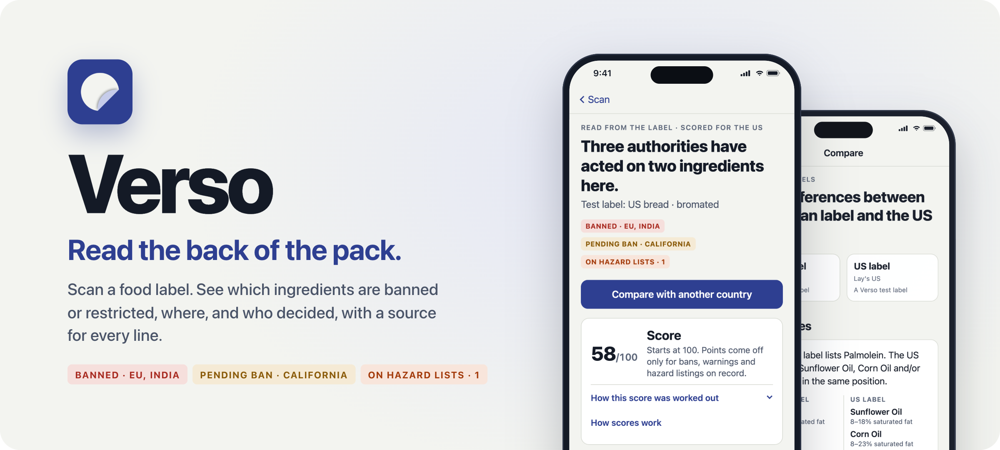
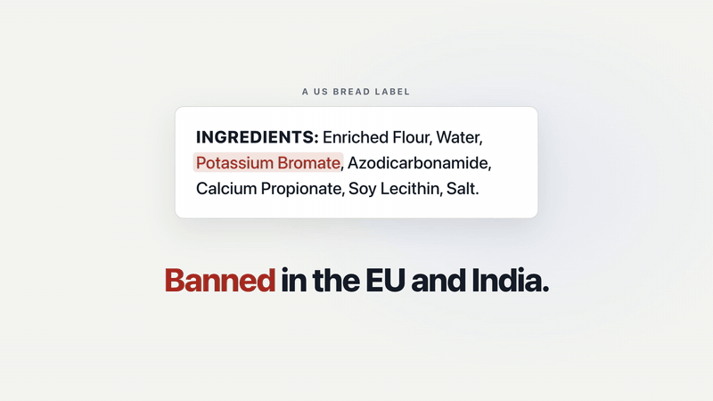
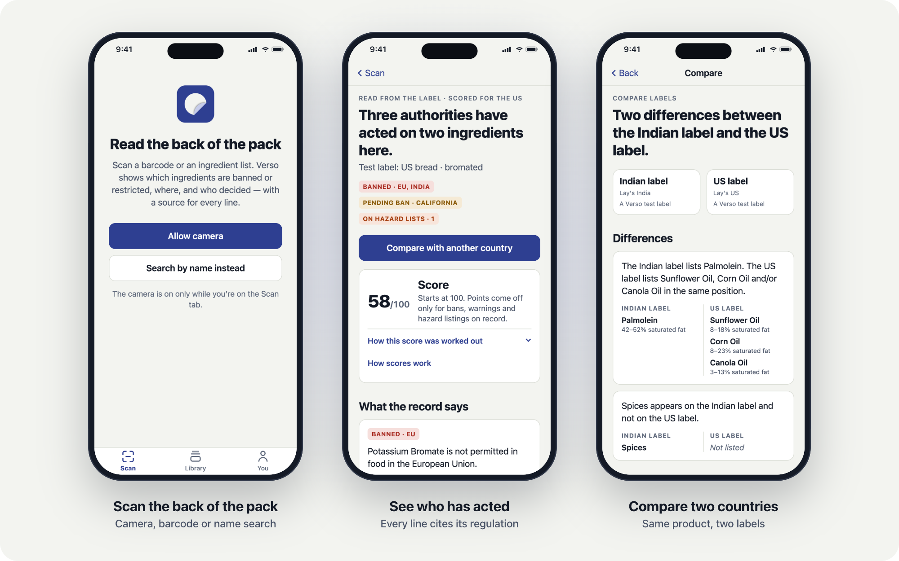
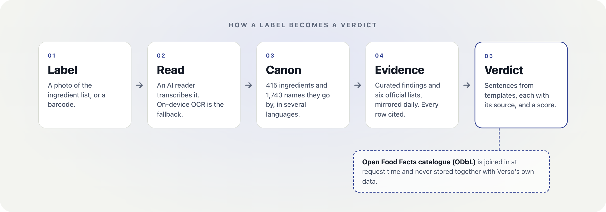

<div align="center">

<picture>
  <source media="(prefers-color-scheme: dark)" srcset="docs/media/hero-dark.png">
  
</picture>

<br>
<br>

<a href="LICENSE"></a>
<a href="data/LICENSE"></a>


**[See it work](#see-it-work)** &nbsp;·&nbsp; **[What it does](#what-it-does)** &nbsp;·&nbsp; **[How it works](#how-it-works)** &nbsp;·&nbsp; **[Sources](#official-sources)** &nbsp;·&nbsp; **[Quick start](#quick-start)** &nbsp;·&nbsp; **[License](#license)**

</div>

## See it work

<div align="center">
  <a href="docs/media/verso-demo.mp4"></a>
  <br>
  <sub><a href="docs/media/verso-demo.mp4">▶&nbsp; Watch the 20-second demo with sound</a></sub>
</div>

## What it does

<table>
<tr>
<td width="50%" valign="top">

### Reads the label
Point the camera at an ingredient list or a barcode. An AI reader transcribes
it, and on-device OCR takes over when there's no signal or no key.

</td>
<td width="50%" valign="top">

### Checks six official lists
Every ingredient is looked up in the EU additives database, FDA's Substances
Added to Food, IARC, California's Prop 65, and the FSSAI and Codex oil
standards, all mirrored daily.

</td>
</tr>
<tr>
<td width="50%" valign="top">

### Shows who decided, with the source
Bans, pending bans, warning labels and hazard listings, by jurisdiction. Each
carries its regulation, a link and the date the list was last checked.

</td>
<td width="50%" valign="top">

### Compares countries
Line up one product's labels from two markets and see exactly what differs.
Lay's in India listed palmolein where the US label listed sunflower, corn or
canola oil.

</td>
</tr>
<tr>
<td colspan="2" valign="top">

### Scores additive hazard, honestly
A 0–100 score where points come off only for bans, warnings and hazard listings
on record. It is withheld when too little of the label has been checked, so an
additive nobody has researched never reads as "fine".

</td>
</tr>
</table>

<picture>
  <source media="(prefers-color-scheme: dark)" srcset="docs/media/screens-dark.png">
  
</picture>

## How it works

<picture>
  <source media="(prefers-color-scheme: dark)" srcset="docs/media/how-it-works-dark.png">
  
</picture>

Four layers, stored apart on purpose:

| Layer | Schema | What it holds |
|:---:|---|---|
| 1 | `product` | Products from [Open Food Facts](https://world.openfoodfacts.org) (ODbL) |
| 2 | `canon` | One entity per ingredient, with every name it goes by, in several languages |
| 3 | `evidence` | Regulatory status, hazard findings, composition and the mirrored official lists, every row cited |
| 4 | `verdict` | Scores, claims and cross-market comparisons |

Two rules hold the design together:

| Rule | How it is enforced |
|---|---|
| **Open Food Facts data is never merged with Verso's own data on disk.** | The two sides are joined at request time. `pnpm lint:layers` checks the migrations and the live database for any foreign key, view or materialized view that crosses the boundary. |
| **A model never decides what differs between two products.** | Differences are computed in code after both lists go through the canon. Every sentence comes from a template, and a claim without a citation can't be inserted: `citation_id` is `NOT NULL`. |

The reasoning in full: [methodology](docs/methodology.md) · [claim templates](docs/claim-templates.md) · [build plan](docs/PLAN.md).

## Official sources

| Source | What Verso reads | Entries |
|---|---|---:|
| [EU Food Additives Database](https://ec.europa.eu/food/food-feed-portal/screen/food-additives/search) | Authorised additives and their conditions of use (Regulation (EC) No 1333/2008) | 412 |
| [FDA Substances Added to Food](https://www.hfpappexternal.fda.gov/scripts/fdcc/?set=FoodSubstances) | Regulated uses by 21 CFR section; Part 189 prohibitions | 3,971 |
| [IARC Monographs, List of Classifications](https://monographs.iarc.who.int/list-of-classifications/) | Carcinogen classifications, Groups 1–3 | 1,128 |
| [California Proposition 65 list](https://oehha.ca.gov/proposition-65/proposition-65-list) | Chemicals listed for cancer or reproductive toxicity | 990 |
| [FSSAI regulation 2.2.1](https://fssai.gov.in/upload/uploadfiles/files/Chapter%202_2_Fats%20oils%20and%20fat%20emulsions.pdf) | India's standards for edible oils | 32 |
| [Codex CXS 210-1999](https://www.fao.org/fao-who-codexalimentarius/codex-texts/list-standards/en/) | International standards for named vegetable oils | 24 |

`pnpm sources:sync` downloads each list, records every added, changed or removed
entry, and refuses a download that shrinks a list by more than a fifth. With
`VERSO_SOURCE_SYNC=daily` the API re-runs it once a day.

## Quick start

You need **Node 22.13+**, **pnpm 11**, **Docker**, and **poppler** (`brew install poppler`)
for the two PDF standards.

```bash
pnpm install
cp .env.example .env              # add an AI reader key if you want photo reading
pnpm db:up && pnpm migrate && pnpm seed
pnpm sources:sync                 # download the official lists
pnpm api                          # API on http://127.0.0.1:4310
```

Then try the app in a browser:

```bash
pnpm --filter @verso/mobile web
```

Development builds show **test labels** on the Scan tab. They run through the
real API and canon and skip only the camera. Before sending a change, run
`pnpm check` (layer lint, tests and the phase 0 criteria).

<details>
<summary><b>Run it on a phone</b></summary>
<br>

`pnpm dev` brings up Postgres, the API and Metro on the Mac's Bonjour name, so a
phone on the same network (or USB) can reach them. Then install a development
build:

```bash
pnpm --filter @verso/mobile ios   # or: android
```

The camera and on-device OCR need a development build, not Expo Go.

</details>

<details>
<summary><b>Configuration</b></summary>
<br>

| Variable | Purpose |
|---|---|
| `DATABASE_URL` | Postgres connection. The default matches `docker-compose.yml` (local development only). |
| `VERSO_OCR_PROVIDER` | Who reads label photos: `gemini`, `anthropic`, `opencode`, or `openai` for any OpenAI-compatible endpoint, a local model included |
| `GEMINI_API_KEY`, `ANTHROPIC_API_KEY`, `VERSO_OCR_API_KEY` | The key for that provider. Keys belong in `.env`, which git ignores. With none set, the phone reads labels on the device. |
| `VERSO_SOURCE_SYNC` | `daily` to re-download the official lists from the API process |

`.env.example` documents every option.

</details>

<details>
<summary><b>Project layout</b></summary>
<br>

```
apps/mobile          Expo app: guided capture, offline cache, verdict and compare screens
services/api         Fastify API: /v1/verdict, /v1/compare, /v1/ocr, /v1/sources, …
packages/db          migrations, one file per layer
packages/canon       ingredient canon: seeder, resolver, on-demand identification
packages/evidence    curated evidence; sources/ parses the official lists, sync.js mirrors them
packages/verdict     score.js, templates.js, build.js, compare.js
packages/shared      label-text normaliser and the product_ref boundary
data/canon           ingredient and synonym source of truth (JSON)
data/evidence        regulatory, hazard, composition and contaminant findings (JSON, every row cited)
tools/               layer lint, source sync, Open Food Facts ingest, dev stack, demos
docs/                plan, methodology, claim templates, brand
```

</details>

## Security and privacy

- The API has no authentication. It is built for local development; don't expose
  it to the internet as is, because `/v1/ocr` spends your AI provider's quota.
- Label photos, and the names of ingredients Verso hasn't seen before, go only to
  the AI provider you configure. With none configured, labels are read on the
  device.
- Please report vulnerabilities privately through
  [GitHub security advisories](https://github.com/aniketshukla1/verso/security/advisories/new),
  not in a public issue.

> [!NOTE]
> **Verso does not produce the regulatory or hazard information it shows.** Each
> item is published by the official source linked beside it, a regulator, a WHO
> agency or a court, and is dated by when that source was last checked. Verso
> can't guarantee it. It is not medical, nutritional or legal advice.

## License

- **Code:** [MIT](LICENSE).
- **Curated data** in `data/canon/` and `data/evidence/`: [CC BY-NC 4.0](data/LICENSE).
  Free for non-commercial use with attribution; ask about commercial use.
- **Third-party material** keeps its own terms: quotations from regulators inside
  `data/evidence/`, the EU additives data behind `data/canon/eu-additives.generated.json`,
  the downloaded official lists, and Open Food Facts data (ODbL), which is fetched
  at runtime and is not in this repository.

---

<div align="center">
<sub><i>Verso</i> is the reverse side of a printed page: the ingredient panel is on the back of the pack.<br>
Built by <a href="https://github.com/aniketshukla1">Aniket Shukla</a>.</sub>
</div>
